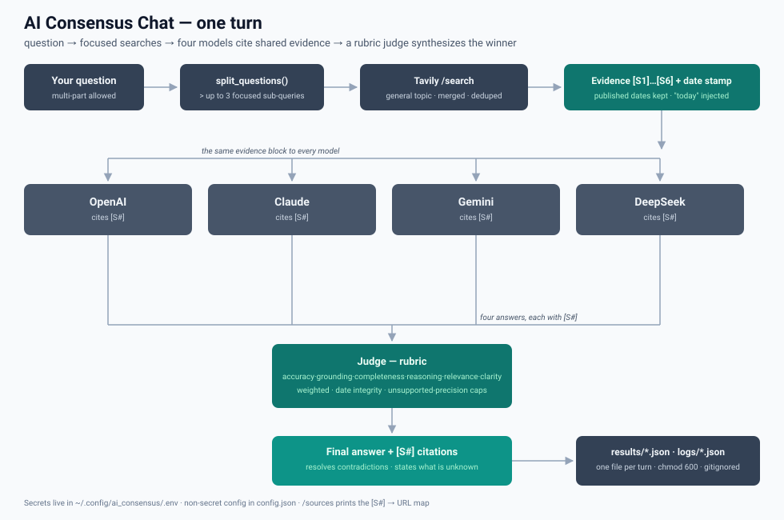

# AI Consensus Chat

A small multi-model chat bot: four LLMs answer the same question against the
same web evidence, and a judge model scores each answer against an explicit
rubric, picks a winner, and synthesizes one cited final answer.

Built to run on [OpenRouter](https://openrouter.ai) with web grounding via
[Tavily](https://tavily.com). One file, no web framework, no queue.

## How it works



One turn: your question is split into focused sub-queries, Tavily retrieves
websites that become the shared `[S1]…[S6]` evidence block, four models answer
against that same evidence (citing `[S#]` tags), and a rubric-driven judge
scores the answers, picks the winner, and synthesizes one cited final answer.

## Quick start

```bash
python3 -m venv .venv && source .venv/bin/activate
pip install -r requirements.txt
# Secrets live OUTSIDE the workspace so agents never see them:
mkdir -p ~/.config/ai_consensus
cp .env.example ~/.config/ai_consensus/.env
# fill in: OPENROUTER_API_KEY (required), TAVILY_API_KEY (for search)
.venv/bin/python main.py
```

At the `You:` prompt type a question. Follow-ups work because the synthesized
answer is kept as the assistant turn.

## Commands

| Command | Effect |
|---|---|
| `/search auto\|on\|off` | control web search for the rest of the session |
| `/sources` | show the websites behind the last answer |
| `/answers` | show every individual model reply |
| `/clear` | forget conversation history |
| `/help`, `/exit` | help / quit |

## How search works

- **The backend is Tavily, not Google.** One Tavily call per turn returns the
  top web *content* pages (analyst sites, news, finance trackers...). Those
  pages are what the models cite as `[S1]`, `[S2]`...; the *search engine*
  itself never appears in the sources — `google.com` is an aggregator, not a
  publisher, so it virtually never shows up as a result even for a "Google
  search". If you specifically want google's own SERP served, that's tabular
  and near-useless for grounding — Tavily's content snippets are what the
  rubric can verify.
- `search_mode = "auto"` (default) searches **only when the question looks
  time-sensitive or information-seeking**, via `SEARCH_HINTS` (`today`,
  `price`, `ipo`, `register`, `when is`, `release date`, a year, ...). The
  console prints the reason: `Search triggered (hints: ipo, when is)`.
- `on` always searches; `off` never.
- **Every prompt receives "Today's date and time" as `now`.** Models anchor
  to their training cutoff by default — that's why older answers reported
  past dates for "when is ...". The date stamp fixes relative dates, and the
  judge rubric hard-rule: an upcoming date (IPO, release, deadline) that the
  evidence does not confirm must be reported as *not announced/unknown*,
  never guessed.
- **Compound questions are searched as separate focused sub-queries.**
  "…in Arkansas ? Also Taylor Swift…" becomes two Tavily queries that are
  merged and de-duplicated, so one noisy blob can't drown both subjects. The
  audit log records the list as `search.sub_queries`.
- **No Tavily time-window filter on purpose.** Measured against real
  queries, `topic: news` + last-month filtering *hurt* event searches
  ("next concert" buried Ticketmaster and venue pages under gossip), so
  freshness is handled by the date stamp in every prompt and the judge's
  date-integrity rule — not by hiding older pages.
- The same evidence block goes to **all four models and the judge**, so
  answers are directly comparable. Models must base factual claims on the
  evidence and cite `[S#]` tags.

### Why citations are `[S2]` instead of URLs

The tags are *index references*, not placeholders: every `[S#]` maps to a
numbered entry in the SOURCES section printed after each answer (and in the
`results/` + `logs/` files under `sources_used`), where the full site title
and URL are shown. URLs are kept out of the flowing text on purpose — they
swallow token budget and readability — and `/sources` reprints the mapping
any time. The judge's `grounding` score (25%) checks that each `[S#]` an
answer cites really points at a source that supports the claim.

## Configuration: `config.json` vs. secrets

Non-secret settings live in the committed **`config.json`** (model lineup,
judge model, search mode, token caps) — edit it freely: put your model ids
from openrouter.ai/models in `"models"`, change `"search_mode"` to
`"auto"|"on"|"off"`, etc.:

```json
{ "models": { "OpenAI": "openai/gpt-6-astra", "Claude": "anthropic/claude-opus-5.5",
              "Gemini": "google/gemini-4-argon", "DeepSeek": "deepseek/deepseek-v4-pro" },
  "judge_model": "anthropic/claude-opus-5.5",
  "search_mode": "auto", "tavily_max_results": 5, "history_turns": 3,
  "answer_max_tokens": 1024, "judge_max_tokens": 4096 }
```

Secrets live ONLY in `~/.config/ai_consensus/.env` (two keys: `OPENROUTER_API_KEY`,
`TAVILY_API_KEY`) — never in config.json. Legacy `MODEL_*`, `WEB_SEARCH`,
`ANSWER_MAX_TOKENS` etc. environment variables still override config.json if you
ever need a one-off run without editing files.

## Output caps (max_tokens)

Configurable in `config.json` (or via `ANSWER_MAX_TOKENS` / `JUDGE_MAX_TOKENS`
env vars on a one-off run):

| Key | Default | What it caps |
|---|---|---|
| `answer_max_tokens` | `1024` | each of the 4 model replies |
| `judge_max_tokens` | `4096` | the judge's JSON report |

For **simple, search-grounded answers** 150–400 tokens is typical; **1024 is a
comfortable cap** with headroom for citations and a few links. The judge needs
more because one JSON doc must carry 4 × (6 dimension scores + explanation) +
final answer + disagreements.

## Outputs: `results/` and `logs/`

Every turn writes two private (`chmod 600`) files with identical
timestamped names:

```
results/2026-10-26_15-41-43_is-it-good-to-invest-in-the-upcoming-anthropic-ipo.json
logs/   2026-10-26_15-41-43_is-it-good-to-invest-in-the-upcoming-anthropic-ipo.json
```

- `results/*.json` — full turn: question, search decision, sources, every model
  answer, failed models (with error strings), full judge evaluation.
- `logs/*.json` — the audit: which websites were retrieved, which `[S#]` each
  model actually cited (`sources_used[].used_by_models`), final-answer
  citations, and a `search` block explaining the decision.

Both directories are gitignored: **standard practice is to commit code + config
templates (`.env.example`), never runtime output.** No API keys, prompts, or
config values are ever written into these files.

## Security posture

- **Secrets live OUTSIDE the workspace**: `~/.config/ai_consensus/.env`
  (`chmod 600`). `main.py` loads that file first; a local `.env` in the
  repo still works as a dev fallback but is not required and is gitignored.
  Because no secrets file sits in the project, coding agents' file tools
  simply cannot read key values. `.env.example` documents variable names
  only.
- `.clineignore`, `.cursorignore`, `.aiexclude`, `.geminiignore`,
  `.aiignore` also list `.env*`, and `.cline/hooks/PreToolUse.sh`
  hard-blocks agent Read/Write/Edit of secret files (enable Hooks in
  Cline settings).
- Result/log files are `chmod 600`, and never contain keys.
- Both the model prompt and the judge prompt carry an instruction-injection
  guard: web evidence and rival answers are untrusted input, never
  instructions.
- Note: ignore files and prompts are **context filters, not security
  boundaries**. Treat keys as compromisable, rotate them, and consider a
  secret manager for anything beyond a personal script.

---

# The eval process (how to analyze and rebuild)

This project is designed to be **evaluated from its own logs**. Each iteration:

1. **Run it** (real questions, not canned ones).
2. **Read the audit log first** — `logs/<timestamp>...json` answers:
   - Did we search? → `search.attempted`
   - Should we have? → `search.hints_matched` (empty = heuristic missed it)
   - Did Tavily deliver websites? → `search.result_count`, `search.error`
   - Did the models *use* the websites? → `sources_used[].used_by_models` and
     `model_citations` (a citation number above `result_count` = hallucinated)
   - Who failed and why? → `failed_models` (model → error string)
3. **Then read the result** — `results/<same name>.json`:
   - Judge scores + explanations per dimension (are the hard rules honored?).
   - `confidence`, `disagreements`, `missing_information` — did the judge
     synthesize or hedge?
4. **Rebuild the weakest link** — candidates are one of:
   - search intent → extend `SEARCH_HINTS` in `main.py`
   - search quality → `TAVILY_MAX_RESULTS`, `search_depth`
   - judge behavior → rubric text / weights in `RUBRIC`, `WEIGHTS`
   - model availability → `MODEL_*` ids, `failed_models` errors
5. **Re-run the same question** and compare the new log/result.

Regression safety net: `.venv/bin/python test_main.py` (offline, mocked).

## Worked example — Eval #1 (Anthropic IPO question)

Question: *"Is it good to invest in the upcoming Anthropic IPO? ...register for
IPO allotment?"* → log `search.result_count: 0`, `sources_used: []`, all models
replied "no web evidence was provided".

Diagnosis from the log alone:
1. `search.attempted` was `false` — the old freshness heuristic contained
   `today/price/latest/...` but not `ipo`, `register`, `allotment`, `deadline`;
   "upcoming Anthropic IPO" contains none of the old keywords.
2. Even if attempted, `tavily_configured` was `false` — `TAVILY_API_KEY` was
   empty in `.env`, so Tavily would have been short-circuited anyway *(the
   current log predates the `search` block; keys in `.env` are still pending)*.
3. `failed_models: ["OpenAI"]` with **no reason** — errors were not logged.

Rebuild: broadened `SEARCH_HINTS` (information-seeking words, no date word
needed), `search_web()` now returns `(sources, error)`, `collect_answers()`
returns `(answers, failures)` with error strings, and every run records the
`search` decision block. `test_main.py` now asserts the IPO question triggers a
search.

### Worked example — Eval #2 (Benson Boone / Taylor Swift)

Question: *"When is the next Benson Boone Concert in Arkansas? Also Taylor
Swift, who will be performing first?"* → log showed 5 irrelevant sources
(Facebook awards posts, a nursing-home PDF, a snow report) — yet the heuristic,
keys, and citation tracking all looked healthy.

Diagnosis:
1. The **whole compound question went to Tavily as one noisy query**, so the
   "search" drifted to unrelated tokens instead of the two entities.
2. The **recency filter (`topic: news` + last-month) was hurting event
   searches**: measured live, news-topic returned gossip/radio roundups and
   buried the actual tour pages. `general` topic with no time window returned
   exactly the right pages (KARK Arkansas concert guide, Simmons Bank Arena,
   Ticketmaster 2026-2027 dates).

Rebuild: removed the time-window filter entirely (freshness lives in the
date stamp + judge's date-integrity rule), and **split compound questions into
focused sub-queries** (`split_questions()`), merged with URL de-duplication,
logged as `search.sub_queries`. The same question now retrieves only relevant
sources and correctly reports *"no next Arkansas date has been announced."*

## Tests

```bash
.venv/bin/python test_main.py   # offline: heuristic, rubric math, JSON,
                                # results/logs writing, REPL loop
```
